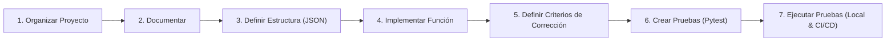

# Taller 3: Proceso de Diseño, Arquitectura IoT & Pruebas Automatizadas

Este proyecto documenta y sintetiza el **Taller 3** de la asignatura de **Internet de las Cosas (IoT)**. 

El propósito central de esta práctica es trabajar con la metodología y buenas prácticas de un equipo de desarrollo profesional: no solo escribir código, sino seguir un **proceso formal de diseño de software** para sistemas distribuidos IoT.

---

## 🎯 Proceso Básico de Diseño



### 1. Organizar el Proyecto
El proyecto separa responsabilidades de forma modular entre el código común agnóstico (`common/`), la interfaz gráfica de usuario (`flet/`), el firmware embebido para la Raspberry Pi Pico WH (`micropython/`) y la suite de pruebas (`tests/`):

```text
Taller_3/
├── README.md                      # Documentación del proceso y uso
├── pytest.ini                     # Configuración del motor de pruebas
├── requirements.txt               # Dependencias de Python
│
├── common/                        # Lógica agnóstica compartida (PC y MicroPython)
│   ├── __init__.py
│   └── messages.py                # Contratos y generadores de mensajes JSON
│
├── micropython/                   # Firmware para Raspberry Pi Pico WH 1 (Thonny)
│   ├── main.py                    # Bucle principal, actuadores y tareas
│   └── mqtt.py                    # Abstracción cliente MQTT para MicroPython
│
├── flet/                          # Aplicación de escritorio / Host
│   ├── main.py                    # Interfaz gráfica de control y monitor
│   └── mqtt.py                    # Gestor de cliente MQTT con Paho-MQTT v2
│
├── tests/                         # Suite de pruebas automatizadas
│   ├── common/
│   │   └── test_messages.py       # Pruebas unitarias de las funciones de datos
│   └── integration/
│       └── test_mqtt.py           # Pruebas de integración del transporte MQTT
│
└── .github/
    └── workflows/
        └── tests.yml              # Pipeline de Integración Continua (CI) en GitHub Actions
```

### 2. Documentar lo que Hacemos
Cada módulo cuenta con docstrings explicativos, tipado estático (type hints) y este archivo de especificación que guía tanto la ejecución local como la integración continua.

### 3. Definir una Estructura de Datos (Contrato JSON)
Para que los nodos (PC y Microcontrolador) puedan comunicarse de manera confiable a través del Broker MQTT, se define un esquema JSON estricto para la programación de tareas (`schedule`):

```json
{
  "action": "schedule",
  "name": "nombre_de_tarea",
  "next_exec_epoch_s": 1776378945,
  "next_exec_ns": 450000000
}
```

Reglas del contrato:
- **`action`**: Debe ser exactamente la cadena `"schedule"`.
- **`name`**: Cadena de texto no vacía con el identificador de la tarea.
- **`next_exec_epoch_s`**: Entero que representa el segundo Unix Epoch de la ejecución. Debe ser mayor al tiempo actual.
- **`next_exec_ns`**: Entero para la fracción en nanosegundos, estrictamente en el rango `0 <= ns < 1_000_000_000`.

### 4. Implementar la Función
En `common/messages.py` se implementa `create_schedule(name: str, delay_s: float) -> dict`:

```python
import time

def create_schedule(name: str, delay_s: float) -> dict:
    now_ns = time.time_ns()
    next_exec_ns = now_ns + int(delay_s * 1_000_000_000)

    return {
        "action": "schedule",
        "name": name,
        "next_exec_epoch_s": next_exec_ns // 1_000_000_000,
        "next_exec_ns": next_exec_ns % 1_000_000_000,
    }
```

### 5. Definir qué Significa que el Resultado sea Correcto
Una ejecución es correcta **única y exclusivamente si**:
1. El diccionario devuelto contiene **exactamente 4 llaves**.
2. Todas las llaves obligatorias existen y contienen los tipos de datos estipulados.
3. El timestamp proyectado está en el futuro (`> time.time()`).
4. La porción en nanosegundos es un entero acotado a menos de un segundo (`< 10^9`).
5. El mensaje es serializable a JSON estándar sin pérdida de fidelidad.

### 6. Crear Pruebas Automáticas
En `tests/common/test_messages.py` se implementan pruebas con `pytest` que verifican cada uno de los criterios:

```python
def test_schedule_at_specific_time():
    msg = create_schedule("test_name", 5.5)
    
    assert len(msg) == 4
    assert "action" in msg
    assert "name" in msg
    assert "next_exec_epoch_s" in msg
    assert "next_exec_ns" in msg
    assert msg["action"] == "schedule"
    assert msg["name"] == "test_name"
    assert isinstance(msg["next_exec_epoch_s"], int)
    assert msg["next_exec_epoch_s"] > time.time()
    assert isinstance(msg["next_exec_ns"], int)
    assert 0 <= msg["next_exec_ns"] < 1_000_000_000
```

### 7. Ejecutar las Pruebas Automáticamente

#### A) En Local:
```powershell
# Desde la carpeta Taller_3:
pytest
```

#### B) En la Nube (GitHub Actions):
El flujo definido en `.github/workflows/tests.yml` corre `pytest` en cada `git push` o `pull request`, bloqueando integraciones que rompan el contrato de datos.

---

## 🚀 Guía de Puesta en Marcha

### Requisitos Previos
- Python 3.10+
- Thonny IDE (para la Raspberry Pi Pico WH 1)

### 1. Configurar Entorno en la PC
```powershell
cd "C:\Users\Admin\OneDrive\Documentos\Ambito Personal\Windows_Git_Hub\IOT\Taller_3"
python -m venv .venv
.\.venv\Scripts\Activate.ps1
pip install -r requirements.txt
```

### 2. Ejecutar la Suite de Pruebas
```powershell
pytest
```
*Salida esperada:*
```text
tests/common/test_messages.py::test_schedule_at_specific_time PASSED
tests/common/test_messages.py::test_schedule_json_serialization PASSED
tests/common/test_messages.py::test_schedule_validation_helper PASSED
tests/common/test_messages.py::test_command_and_status_creation PASSED
tests/integration/test_mqtt.py::test_mqtt_schedule_integration_flow PASSED
tests/integration/test_mqtt.py::test_mqtt_paho_payload_encoding PASSED
6 passed in 0.09s
```

### 3. Ejecutar la Interfaz Gráfica (Flet)
```powershell
python flet/main.py
```
Permite:
- Conectar al broker HiveMQ.
- Generar y validar en vivo mensajes `create_schedule`.
- Publicar tareas y comandos hacia la Raspberry Pi Pico WH.
- Monitorear respuestas y telemetría entrante.

### 4. Ejecutar Firmware en la Raspberry Pi Pico WH (Thonny)
1. Abre **Thonny** y selecciona el intérprete **MicroPython (Raspberry Pi Pico)**.
2. Abre `micropython/main.py` y `micropython/mqtt.py`.
3. Ajusta `SSID` y `PASSWORD` con los datos de tu red Wi-Fi en `main.py`.
4. Guarda los archivos en el dispositivo y presiona **F5 (Ejecutar)**.
5. Observa cómo atiende los mensajes de `schedule` y controla el LED físico onboard.
