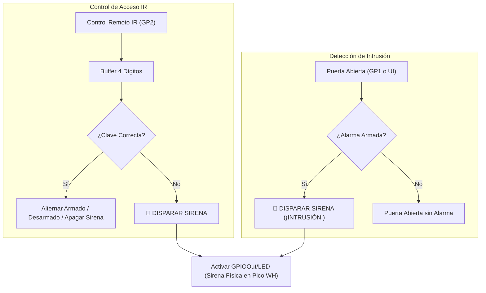

# Taller 5: Control de Acceso, GPIOs, Sensor Infrarrojo (38 kHz, PIO) y Sistema de Alarma en Flet

Este proyecto implementa y consolida de forma profesional el **Taller 5** de IoT (anteriormente nombrado en el repositorio como Taller 7).

---

## 🎯 Objetivos de Aprendizaje

Al finalizar este taller, el estudiante es capaz de:
1. **Utilizar la librería `machine` de MicroPython** (`Pin`, `PWM`, `ADC`, `Timer`).
2. **Configurar y utilizar GPIO** como entradas y salidas digitales con resistencias pull-up/pull-down y anti-rebote.
3. **Comprender el funcionamiento de las clases `GPIOIn` y `GPIOOut`** para mapear eventos físicos a tópicos MQTT.
4. **Comprender el funcionamiento de un receptor infrarrojo**.
5. **Reconocer el papel de la modulación de 38 kHz** en los controles remotos IR.
6. **Comprender el papel de la PIO (Programmable I/O)** del microcontrolador RP2040 en la Raspberry Pi Pico.
7. **Utilizar la clase `IRIn`** para capturar y decodificar tramas del protocolo NEC.
8. **Integrar entradas y salidas físicas con una interfaz nativa en Flet**.
9. **Construir un sistema integral de control de acceso y alarma contra intrusiones**.

---

## 📐 1. Arquitectura y Mapeo de Hardware

```text
               Raspberry Pi Pico WH                     Host PC (Flet)
             ┌──────────────────────┐              ┌───────────────────────────┐
Control IR ─►│ GP2  (Receptor IR)   ├─── MQTT ────►│ [ • ] [ • ] [ • ] [ • ]   │
(38 kHz NEC) │                      │ (alarm/key)  │ Visualizador 4 dígitos    │
             │                      │              │                           │
Puerta       │ GP1  (Sensor Reed)   ├─── MQTT ────►│ Banner de Intrusión       │
Física       │      (GPIOIn)        │ (GPIOIn/GP1) │ "⚠️ ALARMA ¡INTRUSIÓN!"   │
             │                      │              │                           │
Sirena       │ LED  (GPIOOut /      │◄── MQTT ─────│ Botones: Abrir Puerta,    │
Física       │      Pin Onboard)    │ (GPIOOut/LED)│ Cambiar Clave, Reset      │
             └──────────────────────┘              └───────────────────────────┘
```

---

## 🔬 2. Conceptos Clave

### A) La Librería `machine` y la Clase `Pin`
MicroPython ofrece la librería `machine` para el acceso directo a los registros del RP2040:
- `Pin.IN`: Configura el pin como entrada de alta impedancia.
- `Pin.PULL_UP`: Activa la resistencia interna hacia 3.3V (el pin lee `1` en reposo y `0` al presionar el botón a masa).
- `Pin.OUT`: Configura el pin como salida (0V o 3.3V).

### B) Clases `GPIOIn` y `GPIOOut`
- **`GPIOOut`**: Escucha tópicos como `GPIOOut/LED` o `led/LED`. Cuando Flet o el broker publican `{"value": 1}`, la clase conmuta el pin correspondiente sin que el resto del programa deba intervenir.
- **`GPIOIn`**: Lee periódicamente o por interrupción un pin de entrada, aplica una ventana de anti-rebote (*debouncing* de 40 ms) y publica automáticamente al broker cuando hay un cambio de estado.

### C) Modulación de 38 kHz en Infrarrojos
La luz infrarroja está presente en la radiación solar y en fuentes de iluminación artificial. Para evitar que el receptor se sature con ruido óptico, el emisor modula la señal:
- La información no se envía como luz continua, sino en ráfagas que parpadean a **38 kHz**.
- El sensor receptor (ej. VS1838B) integra un fotodiodo, un filtro pasa-banda sintonizado a 38 kHz y un demodulador interno.
- Solo cuando detecta una ráfaga coherente a 38 kHz lleva su salida a nivel bajo (0V). En reposo, entrega 3.3V.

### D) El Papel de la PIO (Programmable I/O) del RP2040
La Raspberry Pi Pico cuenta con **2 bloques PIO con 4 State Machines (máquinas de estado)** independientes del CPU ARM Cortex-M0+:
- Permite escribir micro-código en ensamblador PIO (`@rp2.asm_pio`) que corre a la velocidad del reloj (hasta 125 MHz).
- Mide con precisión de nanosegundos el ancho de los pulsos del protocolo NEC sin consumir ciclos del procesador ni sufrir congelamientos cuando MicroPython ejecuta el recolector de basura (*Garbage Collector*).

---

## 🚨 3. Lógica del Sistema de Alarma y Control de Acceso



---

## 💻 4. Ejecución del Taller 5

### 1. Firmware en la Raspberry Pi Pico WH 1 (Thonny):
1. Conecta la Pico WH vía USB.
2. Abre los archivos de [`micropython/`](file:///C:/Users/Admin/OneDrive/Documentos/Ambito%20Personal/Windows_Git_Hub/IOT/Taller_5/micropython):
   - `gpio_out.py`
   - `gpio_in.py`
   - `ir_in.py`
   - `wifi_manager.py`
   - `mqtt_client.py`
   - `main.py`
3. Ajusta `SSID` y `PASSWORD` con tus credenciales de red en `main.py`.
4. Guarda los archivos en el dispositivo y ejecuta con **F5**.

### 2. Consola de Seguridad en la PC (Flet):
```powershell
cd "C:\Users\Admin\OneDrive\Documentos\Ambito Personal\Windows_Git_Hub\IOT\Taller_5"
python flet/main.py
```

### 3. Comprobación de Requisitos en la Interfaz:
1. **Clave por defecto**: Digita `1111` apuntando el control remoto a GP2 (o usando el teclado virtual en pantalla). Verás el armado del sistema (`🔒 SISTEMA ARMADO`).
2. **Intrusión**: Con el sistema armado, haz clic en **"Simular: ABRIR PUERTA"** (o abre el sensor en GP1). Verás cómo el banner cambia inmediatamente a:
   `🚨 ⚠️ ALARMA ¡INTRUSIÓN! (SIRENA DISPARADA)`
   y el LED onboard de la Pico WH se enciende físicamente en tiempo real.
3. **Desactivación**: Vuelve a digitar `1111` para apagar la sirena y desarmar el sistema.
4. **Cambio de Clave**: Pulsa **"🔑 CAMBIAR CLAVE"**, digita la clave actual (`1111`) y luego la nueva clave (ej. `2222`).
