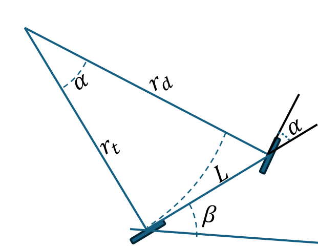
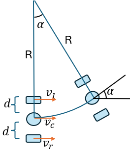
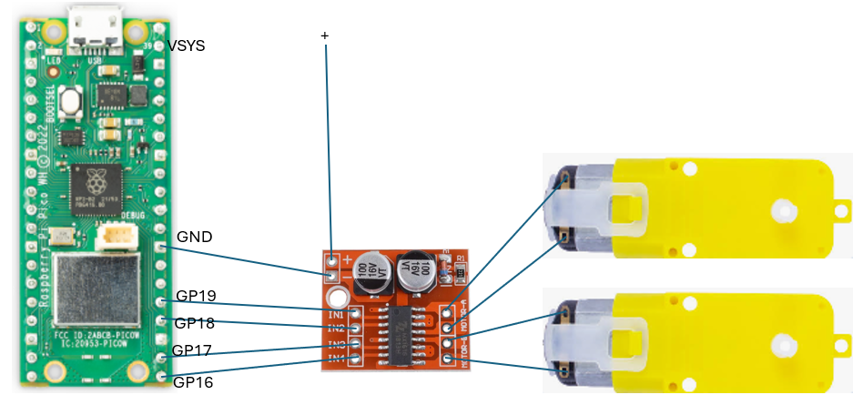
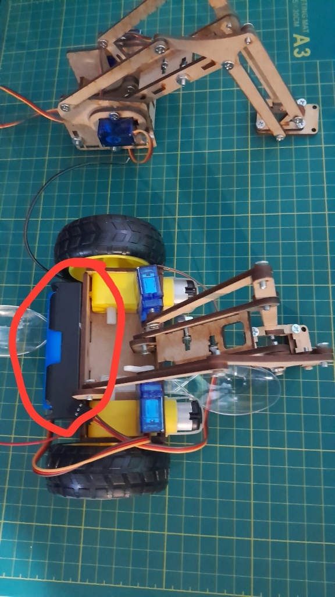

# Taller 8 (Proyecto Final): Clase `CAR` — Modelo de la Bicicleta y Cinemática Diferencial

**Universidad Distrital Francisco José de Caldas (UDFJC)**  
*Laboratorio de Internet de las Cosas (IoT) y Sistemas Embebidos*

---

## 1. Objetivos del Proyecto Final

1. Comprender y modelar matemáticamente el **Modelo Cinemático de la Bicicleta** para vehículos con dirección delantera.
2. Deducir e implementar las ecuaciones de **Cinemática Diferencial Directa e Inversa** para controlar la locomoción coordinada de las dos ruedas de un robot diferencial.
3. Realizar el montaje electrónico entre la **Raspberry Pi Pico W**, el puente H dual (**MX1508 / L298N**), la **batería Li-ion 18650** y los dos motorreductores DC.
4. Implementar la clase **`CAR`** en MicroPython sobre el planificador cooperativo (`Scheduler` + `Task`) y bus de eventos (`Node` + `PubSubMQTT`), capaz de recibir comandos de rapidez lineal $v$, velocidad angular $w$ y tiempo de ejecución $t$ sin bloquear el microcontrolador.
5. Desarrollar la interfaz gráfica en **Flet** para despachar las tres trayectorias fundamentales:
   - **Avanzar en línea recta $1\text{ metro}$.**
   - **Generar $1/4$ de círculo de $1\text{ metro}$ de radio a la derecha.**
   - **Generar $1/4$ de círculo de $1\text{ metro}$ de radio a la izquierda.**

---

## 2. Fundamentación Matemática

### 2.1. Modelo de la Bicicleta



El modelo de la bicicleta simplifica el movimiento de un vehículo de distancia entre ejes $L$ con dirección en la rueda delantera a un ángulo de timón $\alpha$:

$$r_d = \frac{L}{\sin(\alpha)}, \qquad r_t = \frac{L}{\tan(\alpha)}$$

Si el vehículo barre un ángulo de giro $\beta$ (en radianes):
- **Arco descrito por la rueda trasera:** $S_t = \beta \cdot r_t$
- **Arco descrito por la rueda delantera:** $S_d = \beta \cdot r_d$

#### Ecuaciones Diferenciales de Movimiento:
$$\dot{x} = v \cdot \cos(\beta)$$
$$\dot{y} = v \cdot \sin(\beta)$$
$$\dot{\beta} = \frac{v}{L} \cdot \tan(\alpha)$$

Donde:
- $(x, y)$: Posición del vehículo en el plano cartesiano.
- $\beta$: Orientación del vehículo respecto al eje $X$ (rad).
- $v$: Velocidad lineal en la dirección de la rueda trasera ($\text{m/s}$).
- $\alpha$: Ángulo del timón de la rueda delantera respecto al chasis (rad).
- $L$: Distancia entre los ejes delantero y trasero ($\text{m}$).

---

### 2.2. Cinemática Diferencial (Dos Ruedas Motrices)



Sea $d$ la distancia desde el centro geométrico del robot hasta cada rueda (por tanto, la separación total entre ruedas o *trocha* es $2d$). Cuando el robot describe una trayectoria circular de radio $R$ con velocidad angular $\omega = \dot{\alpha}$:

$$v_l = \dot{\alpha}(R - d)$$
$$v_c = \dot{\alpha}R$$
$$v_r = \dot{\alpha}(R + d)$$

#### A. Cinemática Inversa (De $(v, w)$ del carro a velocidades de rueda $(v_l, v_r)$):
Despejando $R = v_c / \dot{\alpha}$ y sustituyendo $v = v_c$ y $w = \dot{\alpha}$:

$$\boxed{v_l = v - w \cdot d}$$
$$\boxed{v_r = v + w \cdot d}$$

- Si **$w = 0$**: $v_l = v_r = v \implies$ El robot avanza en **línea recta**.
- Si **$w > 0$** (giro antihorario / **a la izquierda**): $v_r > v_l \implies$ La rueda derecha es la rueda exterior y recorre mayor distancia.
- Si **$w < 0$** (giro horario / **a la derecha**): $v_l > v_r \implies$ La rueda izquierda es la rueda exterior y recorre mayor distancia.

#### B. Cinemática Directa (De velocidades de rueda $(v_l, v_r)$ a $(v, w)$ del carro):
Sumando y restando las ecuaciones anteriores:

$$\boxed{v = v_c = \frac{v_r + v_l}{2}}, \qquad \boxed{w = \dot{\alpha} = \frac{v_r - v_l}{2d}}$$

---

### 2.3. Cálculo Exacto de los 3 Comandos Solicitados en Flet

Tomando como parámetros nominales del chasis:
- Semitrocha: $d = 0.0675\text{ m}$ ($2d = 13.5\text{ cm}$ entre centros de rueda).
- Rapidez lineal nominal: $v = 0.20\text{ m/s}$.

| Maniobra Solicitada | Distancia / Radio | $v\text{ (m/s)}$ | $w\text{ (rad/s)}$ | Tiempo $t\text{ (s)}$ | $v_l\text{ (m/s)}$ | $v_r\text{ (m/s)}$ |
| :--- | :---: | :---: | :---: | :---: | :---: | :---: |
| **1. Recta $1\text{ m}$** | $D = 1.0\text{ m}$ | $0.200$ | $0.000$ | $t = \frac{1.0}{0.20} = \mathbf{5.00\text{ s}}$ | $0.2000$ | $0.2000$ |
| **2a. $1/4$ Círculo ($R=1\text{ m}$) a Izquierda** | $R = 1.0\text{ m}, \Delta\alpha = +\frac{\pi}{2}$ | $0.200$ | $+\frac{0.20}{1.0} = \mathbf{+0.200}$ | $t = \frac{\pi/2}{0.20} = \mathbf{7.854\text{ s}}$ | $0.1865$ | $0.2135$ |
| **2b. $1/4$ Círculo ($R=1\text{ m}$) a Derecha** | $R = 1.0\text{ m}, \Delta\alpha = -\frac{\pi}{2}$ | $0.200$ | $-\frac{0.20}{1.0} = \mathbf{-0.200}$ | $t = \frac{\pi/2}{0.20} = \mathbf{7.854\text{ s}}$ | $0.2135$ | $0.1865$ |

> **Verificación geométrica del cuarto de círculo ($R = 1.0\text{ m}$):**
> - Arco recorrido por el centro del robot: $S_c = v \cdot t = 0.20 \times 7.85398 = \frac{\pi}{2}\text{ m} \approx 1.5708\text{ m}$.
> - Ángulo total girado: $\Delta\alpha = |w| \cdot t = 0.20 \times 7.85398 = \frac{\pi}{2}\text{ rad} = 90^\circ$ ($1/4$ de vuelta).

---

## 3. Esquema de Conexiones y Montaje Físico

### 3.1. Diagrama de Conexión (Raspberry Pi Pico W + Puente H Dual)



| Pin Raspberry Pi Pico W | Terminal Puente H (MX1508 / L298N) | Función en Clase `CAR` |
| :---: | :---: | :--- |
| **`GP19`** (Pin 25) | **`IN1`** | PWM Motor Izquierdo (A) — Canal 1 |
| **`GP18`** (Pin 24) | **`IN2`** | PWM Motor Izquierdo (A) — Canal 2 |
| **`GP17`** (Pin 22) | **`IN3`** | PWM Motor Derecho (B) — Canal 1 |
| **`GP16`** (Pin 21) | **`IN4`** | PWM Motor Derecho (B) — Canal 2 |
| **`GND`** (Pin 23 / 38) | **`-` (GND)** | Tierra común entre Pico W, Puente H y Batería 18650 |
| **`VSYS` / Batería `+`** | **`+` (VCC)** | Alimentación de potencia para los motores DC |
| **`GP12`** (Opcional) | **Señal Servo SG90** | Control angular del brazo mecánico superior |

### 3.2. Chasis Físico y Alimentación con Batería 18650



> [!TIP]
> **Consideraciones prácticas sobre el portabaterías 18650 (señalado en rojo en el chasis):**
> 1. **Tierra Común (`GND`):** El polo negativo (`-`) del portabaterías 18650 debe estar unido al `GND` del puente H y a un pin `GND` de la Raspberry Pi Pico W para que las señales PWM de `GP16–GP19` tengan referencia eléctrica.
> 2. **Compensación de Fricción Estática (`deadzone`):** Los motorreductores amarillos TT tienen una zona muerta mecánica ($\sim 28\%$ de PWM) por debajo de la cual el motor zumba sin girar. La clase `CAR` compensa automáticamente esta zona muerta y permite calibrar `v_max`, `d` e inversión de giro en vivo desde Flet sin recargar el código.

---

## 4. Estructura del Proyecto

```text
Taller_8/
├── README.md                      # Documentación teórica, fórmulas y guía de montaje
├── requirements.txt               # Dependencias: flet, paho-mqtt, pytest
├── main.py                        # Lanzador directo de la interfaz gráfica Flet
├── img/                           # Diagramas cinemáticos, esquema de pines y foto real
│   ├── modelo_bicicleta.png
│   ├── cinematica_diferencial.png
│   ├── conexiones_pico_motores.png
│   └── robot_fisico_chasis.jpg
├── common/
│   └── kinematics.py              # Motor matemático compartido (Bicicleta + Diferencial)
├── flet/
│   ├── main.py                    # Interfaz Flet con los 3 comandos + control (v,w,t) + calibración
│   └── mqtt.py                    # Cliente MQTT asíncrono Paho v2
├── micropython/
│   ├── car.py                     # Clase CAR (Cinemática Diferencial no bloqueante sobre Task)
│   ├── pwm_out.py                 # Clase PWMOut para control de pines GP19..GP16 y servos
│   ├── servo.py                   # Clase Servo para el mecanismo superior del robot
│   ├── scheduler.py               # Planificador cooperativo en tiempo real
│   ├── task.py                    # Clase base Task con medición en RingBuffer
│   ├── node.py                    # Bus Pub/Sub local PicoROS
│   ├── pubsub_mqtt.py             # Transporte MQTT no bloqueante
│   ├── watchdog_task.py           # Supervisión de latido y memoria RAM
│   ├── wifi_manager.py            # Conexión Wi-Fi automática
│   ├── ring_buffer.py             # Estadísticas de tiempos de ejecución
│   ├── util.py                    # Funciones auxiliares
│   └── main.py                    # Punto de entrada para la Raspberry Pi Pico W
└── tests/
    └── test_kinematics.py         # Pruebas unitarias automatizadas con pytest (5/5)
```

---

## 5. Instrucciones de Ejecución

### Paso 1: Ejecutar las Pruebas Unitarias (PC)
```bash
cd "C:\Users\Admin\OneDrive\Documentos\Ambito Personal\Windows_Git_Hub\IOT\Taller_8"
python -m pytest tests/test_kinematics.py -v
```

### Paso 2: Cargar el Firmware en la Raspberry Pi Pico W (Thonny)
1. Copie todos los archivos de la carpeta [`micropython/`](file:///C:/Users/Admin/OneDrive/Documentos/Ambito%20Personal/Windows_Git_Hub/IOT/Taller_8/micropython) a la raíz de la Raspberry Pi Pico W.
2. Verifique su `SSID` y `PASSWORD` en [`micropython/main.py`](file:///C:/Users/Admin/OneDrive/Documentos/Ambito%20Personal/Windows_Git_Hub/IOT/Taller_8/micropython/main.py).
3. Ejecute `main.py` en la Pico W.

### Paso 3: Iniciar el Panel de Control en Flet (PC)
```bash
cd "C:\Users\Admin\OneDrive\Documentos\Ambito Personal\Windows_Git_Hub\IOT\Taller_8"
python main.py
```
